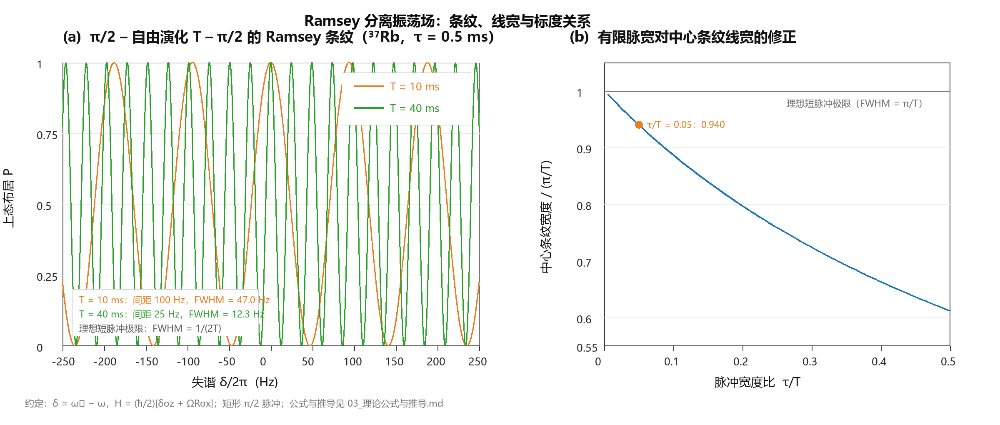

# Ramsey 量子干涉仪：文献综述

> 整理：2026-10 ｜ 配套：02 精读笔记、03 公式推导、04 路线建议、05 参考文献.bib
> 图：figures/ramsey_fringes.png（由 tools/ramsey_fringe_plot.py 生成，可复现）

---

## 0. 摘要

Ramsey 的分离振荡场方法（1950）用"两段短脉冲 + 中间自由演化 T"取代"一段长脉冲"，把谱线宽度从 1/τ 压缩到 ~1/(2T)，同时让原子在两个脉冲之间完全脱离光场。这一看似简单的时序改造，成为此后七十年精密谱学与量子计量的通用骨架：原子钟（铯喷泉、氢激射器、光晶格钟、CPT 钟）、物质波干涉仪（Ramsey–Bordé、光脉冲原子重力仪/陀螺仪）、固态与离子量子传感（NV 色心、囚禁离子）以及多体量子模拟中的谱学探针，都是它的不同"外壳"。近十年，Ramsey 干涉仪的主战场从"提高 Q 值"转向"降低量子噪声与系统误差"：自旋压缩/纠缠把灵敏度推到标准量子极限以下（光钟上已演示 4 dB 量级增益），hyper-Ramsey 与自平衡方案把光频移误差压低 2–4 个量级。本综述按"物理内核 → 历史脉络 → 四种现代形态 → 平台比较 → 关键技术问题 → 量子增强 → 冷原子接口 → 选题地图"组织，所有论断尽量落到 05_参考文献.bib 中的具体条目。

---

## 1. 物理内核

### 1.1 从 Rabi 到 Ramsey

把原子简化为两能级系统（基态 |g⟩、激发态 |e⟩，跃迁频率 ω₀），用频率 ω、拉比频率 Ω_R 的驱动场作用时间 τ。在旋转坐标系中，失谐 δ = ω₀ − ω，有效拉比频率 Ω_eff = √(Ω_R² + δ²)，脉冲面积 θ = Ω_eff τ。从 |g⟩ 出发，单脉冲结束时的上态布居为

$$P_{|e\rangle}(\delta)=\frac{\Omega_R^2}{\Omega_{\rm eff}^2}\sin^2\!\left(\frac{\theta}{2}\right)$$

这就是 **Rabi 谱**：共振处 P 随 τ 振荡（拉比振荡），而扫频时线宽由 τ 决定（~1/τ）。要提高分辨率只能加长 τ，但原子在光场里待得越久，光频移、功率漂移、自发辐射、原子间相互作用的影响越大——这是"单脉冲谱学"的天花板。

### 1.2 两个分离场的三种等价图像

**（i）时间域图像。** 第一个 π/2 脉冲把 |g⟩ 变成 (|g⟩ + |e⟩)/√2；随后原子在无场条件下自由演化 T，两个分量积累相对相位 δT；第二个 π/2 脉冲把相位差转换为布居差，得到 P = cos²(δT/2)。原子"带着相位走过 T，再被第二个脉冲读出来"。

**（ii）频率域图像。** 两个相隔 T 的短脉冲，其频谱是宽度 ~1/τ 的包络被周期为 1/T 的干涉条纹调制：条纹来自"原子只在这两个时刻被'询问'"，相当于对驱动场做了两点采样。条纹宽度 ~1/(2T) 而包络宽度 ~1/τ，两者之比给出 Q 的提升因子 ~T/τ。

**（iii）干涉仪图像。** 把内部态（|g⟩、|e⟩）看成两条路径：第一脉冲是分束器，自由演化是两条路径积累相位差，第二脉冲是合束器。P 就是两条路径的干涉结果。**这正是原子干涉仪的原型**：把内部态换成动量态，就得到光脉冲原子干涉仪；把两束脉冲换成四个作用区，就得到 Ramsey–Bordé 干涉仪。

*图注：(a) 87Rb 基态超精细跃迁（6.834682 GHz）上、π/2–T–π/2 序列的条纹，T = 10 ms（间距 100 Hz）与 40 ms（间距 25 Hz），矩形 π/2 脉冲 τ = 0.5 ms；由精确公式计算，可见有限脉宽带来的轻微非对称与窄化。(b) 中心条纹宽度随脉冲占空比 τ/T 的修正：短脉冲极限为 π/T（即 1/(2T) Hz），τ/T = 0.05 时约为理想值的 0.94 倍。*

### 1.3 精确公式与关键标度

两个相同矩形脉冲之后的精确结果为（推导与数值验证见 03）

$$P(\delta)=4\sin^2\!\frac{\theta}{2}\left(\frac{\Omega_R}{\Omega_{\rm eff}}\right)^{2}
\left[\cos\frac{\theta}{2}\cos\frac{\delta T}{2}
-\frac{\delta}{\Omega_{\rm eff}}\sin\frac{\theta}{2}\sin\frac{\delta T}{2}\right]^{2}$$

在"短脉冲 + π/2"极限（θ → π/2，τ ≪ T，δ ≪ Ω_R）下退化为 $P=\cos^2(\delta T/2)$：条纹间距 $1/T$（Hz），中心条纹半高全宽 $1/(2T)$（Hz）。有限脉宽会带来三类修正：条纹轻微非对称、(Ω_R/Ω_eff)² 的包络压低条纹翼、以及约 5%–40% 的窄化（τ/T 从 0.05 增到 0.3 时）。这些量都可以用 tools/ramsey_fringe_plot.py 复算。

| 量 | 短脉冲极限 | 物理意义 |
|---|---|---|
| 条纹间距（Hz） | 1/T | 扫频时相邻峰的间隔，决定测量范围/模糊度 |
| 中心条纹 FWHM（Hz） | 1/(2T) | 线宽，决定频率分辨本领 |
| 品质因数 | Q ≈ νT | 6.8 GHz、T = 1 s → 7×10⁹ |
| 条纹边缘最大斜率 | ∂P/∂δ ∝ T | 鉴频灵敏度，把布居噪声变成频率噪声 |
| 单次频率不确定度 | δν = 1/(2πT√N) | 投影噪声（标准量子极限） |

### 1.4 为什么 Ramsey 至今仍是主流

1. **Q 值由 T 而非脉冲长度决定**：原子在自由演化期间不受光场扰动，系统误差（光频移）只发生在两个短脉冲内，占总时间的比例 τ/T 很小。
2. **通用性**：只要能把两个能级耦合起来（微波、拉曼光、里德堡、声子、超导比特），就能用同一套时序；换平台几乎不用换理论。
3. **可直接升级为干涉仪**：加一个"中间镜面脉冲"就变成灵敏度正比于 T² 的惯性传感器（下一节）。
4. **量子增强的天然载体**：条纹的布居读出直接对应投影噪声，压缩/纠缠的收益能直接换算成频率稳定度的提升。

---

## 2. 历史脉络（选点，均有文献支撑）

| 年份 | 事件 | 文献 |
|---|---|---|
| 1937–1939 | Rabi 发展分子束磁共振方法，测 Li、F 的核磁矩 | Rabi, Millman, Kusch, Zacharias 1939（A_rabi1939） |
| 1949 | Ramsey 提出"分离振荡场"构想（一页通讯） | Ramsey 1949（A_ramsey1949） |
| 1950 | 完整理论：线宽由 T 决定，并给出实验实现方案 | **Ramsey 1950（A_ramsey1950）** |
| 1955 | 铯束钟成为频率标准（Essen & Parry；见 Ramsey 的历史综述） | Ramsey 2005（A_ramsey2005） |
| 1960 | 氢激射器：分离场 + 腔，稳定度跃升 | Ramsey 1990 诺奖演讲（A_ramsey1990）回顾 |
| 1980 | 方法论的经典回顾（Physics Today） | Ramsey 1980（A_ramsey1980） |
| 1989 | Bordé 提出内部态标记原子干涉仪（四区结构） | Bordé 1989（B_borde1989） |
| 1991–1992 | Kasevich–Chu 用受激拉曼跃迁实现光脉冲原子干涉仪并测 g | B_kasevich1991a / B_kasevich1992 |
| 1997–1999 | 原子干涉陀螺仪；自由落体测 g 达 10⁻⁸ g 量级 | B_gustavson1997 / B_peters1999 |
| 2009 | 原子/分子光学与干涉的权威综述 | Cronin RMP（B_cronin2009） |
| 2010 | 原子干涉验证引力红移（10⁻⁹ 量级） | Müller et al.（B_muller2010） |
| 2015 | 光学原子钟综述：系统误差进入 10⁻¹⁸ | Ludlow RMP（C_ludlow2015） |
| 2017–2018 | 三维晶格钟 5×10⁻¹⁹/1 h；原子反冲测精细结构常数（0.20 ppb） | C_campbell2017 / B_parker2018 |
| 2019 | SAGE 空间计划（光钟 + 原子干涉） | F_tino2019 |
| 2020–2023 | 光钟跃迁上的纠缠（4.4 dB）；里德堡压缩光钟（~4 dB） | D_pedrozo2020 / D_eckner2023 |

**一句话历史**：1949–1960 是"方法 → 频标"的十年；1989–1999 是"方法 → 干涉仪"的十年；2010 至今是"方法 → 量子增强与系统误差极限"的二十年。

---

## 3. 现代形态 I：频标中的 Ramsey

**铯喷泉（微波频标）。** 冷原子团上抛、两次经过同一微波腔，相当于"两个分离场"，T ≈ 0.5 s，线宽 ~1 Hz，Q ~ 10⁹。喷泉钟把"渡越展宽"换成"自由演化"，是 Ramsey 方法最直接的工程化。综述见 Wynands & Weyers 2005（C_wynands2005）。

**光钟。** 把微波换成 10¹⁵ Hz 的光频，同样的 T 给出高五个量级的 Q。当前最好的光钟（离子与中性原子）系统不确定度已到 10⁻¹⁸ 量级，稳定度受本地振荡器（超稳激光）与 Dick 效应限制；Ludlow RMP 2015（C_ludlow2015）是必读。三维费米简并晶格钟（Campbell 2017，C_campbell2017）用 5×10⁻¹⁹/1 h 的比较精度展示了"多原子 + 低相互作用"的路线。

**CPT 钟。** 用相干布居囚禁的暗态代替微波腔，实现芯片级钟；Ramsey 序列在 CPT 中的推广（三脉冲、双暗态）见 Vanier 2005（C_vanier2005）与 2024 年综述 Han, Lu, Lee（C_han2024，冷原子 CPT 中的 Ramsey 干涉，开放获取）。

**光频移：Ramsey 谱学的主要敌人。** 钟激光在脉冲期间造成的 AC Stark 频移会直接变成钟误差。两类主流对策：
- **hyper-Ramsey（Yudin 2010，C_yudin2010）**：用不等长、相位受控的多脉冲（典型为 π/2–π–π/2 的复合序列）让光频移的一阶项在条纹中心相消，摘要给出"比常规 Ramsey 与单脉冲 Rabi 压低 2–4 个量级"。
- **自平衡 Ramsey（Sanner 2018，C_sanner2018）**：把两段相位一致、时长不等的 Ramsey 序列交替测量，对光频移、相位啁啾、瞬态塞曼移动等"询问相关"误差做主动平衡，在 ¹⁷¹Yb⁺ 电八极钟上演示。

这两条思路对任何"需要高准确度"的 Ramsey 实验都有直接借鉴价值，也是当前光钟论文的高频关键词。

---

## 4. 现代形态 II：物质波干涉（Ramsey–Bordé 与光脉冲）

**Bordé 的四区结构（1989，B_borde1989）。** 把两个 Ramsey 脉冲扩展成四个行波作用区，并用内部态标记两条路径，构成对转动、重力、重力梯度敏感的干涉仪。它是"原子光学版 Ramsey"：分束器/合束器由光场充当，路径差由动量转移决定。

**Kasevich–Chu 的光脉冲方案（1991–1992，B_kasevich1991a/b，B_kasevich1992）。** 用受激拉曼跃迁（两束激光、有效波矢 k_eff）实现动量分束：π/2–π–π/2 的 Mach–Zehnder 构型，相位差

$$\Delta\Phi = k_{\rm eff}\, g\, T^{2}$$

对重力加速度 g 的灵敏度正比于 T²（T 为脉冲间隔）。与 Ramsey 的两脉冲相比，多出的中间 π 脉冲让两条路径在空间上真正分开，因而对惯性量敏感；这也是原子重力仪、重力梯度仪、陀螺仪的共同基础（综述：Cronin RMP 2009，B_cronin2009；国内综述：Yuan, Wu, Yang 2023，B_yuan2023）。

**已实现的应用**：测 g（Peters 1999 达 ~10⁻⁸ g）、测转动（Gustavson 1997）、验证引力红移（Müller 2010）、测量精细结构常数（Parker 2018，0.20 ppb）、检验等效原理（综述与方案：Roura 2017 讨论如何规避海森堡不确定性对分离/相干时间的限制，B_roura2017；B_yuan2023）、空间计划（SAGE，F_tino2019）。

**系统误差清单**（做原子干涉仪绕不开）：拉曼光波前曲率与相位噪声、二阶塞曼效应、Coriolis 力、重力梯度、自引力、黑体辐射、探测非线性。它们在 Ramsey 微波实验中大多以"频移 + 展宽"的形式出现，处理方法可以互相移植。

---

## 5. 现代形态 III：量子传感中的 Ramsey

**NV 色心。** 金刚石 NV 的电子自旋可用微波做 Ramsey：π/2–T–π/2 读出相位，对磁场、温度、电场敏感；把多个脉冲改造成 CPMG/XY 序列（动力学解耦），可把相干时间从 T₂*（μs）延长到 T₂（ms）。经典实验：de Lange et al. 2010（E_delange2010）用动力学解耦把单自旋与自旋浴解耦；灵敏度优化的系统分析见 Barry RMP 2020（E_barry2020），平台综述见 Degen RMP 2017（H_degen2017）。

**囚禁离子。** 同样的两脉冲逻辑用于离子钟跃迁与量子门校准；Wineland et al. 1998（E_wineland1998）系统总结了相干操控的实验问题（含 Ramsey 谱与自旋回波）。近年甚至用离子的振动模式做"因果非线性量子力学"检验（Broz 2023，E_broz2023），说明 Ramsey 干涉仪同时是基础物理检验工具。

**共同点**：在这些平台上，Ramsey 序列的角色是"把待测的相位/频率转成可读的布居差"，其精度最终由相干时间 T₂ 与读出保真度决定——这正是 03 中灵敏度公式各项的来源。

---

## 6. 现代形态 IV：多体与量子模拟中的 Ramsey

当"两能级"换成多体系统，Ramsey 序列变成一种"全局猝发 + 干涉读出"的多体谱学工具。代表工作：Islam et al. 2015（G_islam2015）在光晶格中用两套相同副本的量子多体态相互干涉（twin-copy 干涉），直接测得纯度、Rényi 纠缠熵与互信息。其思想与 Ramsey 一脉相承：让两个"拷贝"积累相对相位，再用干涉把不可直接测量的全局量转成可测量的涨落。

对冷原子实验的启示：如果你的平台能做单格点分辨或全局自旋操控，Ramsey 型序列可以用来探测退相干、纠缠增长与多体局域化——这是"从频标走向量子模拟"的一条现实路径，但门槛（单原子分辨、低熵制备）明显更高。

---

## 7. 量子增强：把 1/√N 变成 1/N

**标准量子极限。** N 个独立原子、布居差读出，单次测量的布居噪声为 σ_P = 1/(2√N)（投影噪声，Itano 1993，D_itano1993），对应单次频率不确定度 δν = 1/(2πT√N)——这就是 SQL。任何"原子数多但无关联"的实验都受它限制。

**压缩与纠缠。** 若能把测量分量的噪声压到 ξ²（相对 SQL 的方差比），灵敏度改善为 1/ξ（Wineland 1994，D_wineland1994；综述 Ma 2011，D_ma2011）。Huelga 1997（D_huelga1997）与 Bollinger 1996（D_bollinger1996）给出频标中纠缠收益的理论框架；Giovannetti–Lloyd–Maccone（D_giovannetti2011）与 Pezzè RMP 2018（D_pezzè2018）是量子计量理论的两篇总纲，后者系统处理"有噪声、有损耗时纠缠还剩多少收益"。

**实验进展。** 光钟上：Pedrozo-Peñafiel et al. 2020（D_pedrozo2020）在光学跃迁上制备多原子纠缠态，实现 Allan 偏差低于 SQL，报告 4.4 dB 的计量增益；Eckner et al. 2023（D_eckner2023）用里德堡相互作用在可编程光钟阵列中产生自旋压缩，增益接近 4 dB，并做了两个独立压缩态之间的同步频率比较。这说明"纠缠增强的 Ramsey 干涉"已从概念走向可用的频标技术，但增益仍在 ~10 dB 以内，且对损耗、读出效率、态制备时间极其敏感。

**给实验者的提醒**：量子增强的收益是"乘法因子"，而系统误差与死时间是"加法/偏置项"。在系统误差还没压到 10⁻¹⁵ 量级之前，压缩带来的 4 dB 通常不是瓶颈——这也是 04 中把"先做干净的单原子/小系综 Ramsey"排在"上压缩"前面的原因。

---

## 8. 平台比较

| 平台 | 典型 T | 典型线宽/灵敏度 | 优势 | 主要困难 | 代表文献 |
|---|---|---|---|---|---|
| 热原子束（Cs/Rb） | ms | kHz–Hz | 简单、成熟、可做教学 | 渡越展宽、束流噪声 | A_ramsey1950；C_wynands2005 |
| 冷原子喷泉 | 0.1–1 s | ~1 Hz | Q 高、系统误差可控 | 体积大、上抛与探测 | C_wynands2005 |
| 光晶格钟 | ~1 s | mHz | 10⁻¹⁸ 准确度 | 超稳激光、Dick 效应 | C_ludlow2015；C_campbell2017 |
| 单离子光钟 | ~1 s | mHz | 系统误差最小 | 信号弱、需长时间平均 | C_ludlow2015；E_wineland1998 |
| 光脉冲原子干涉仪 | 10–100 ms | δg/g ~ 10⁻⁹/发 | T² 标度、测惯性量 | 波前、振动、Coriolis | B_kasevich1992；B_peters1999；B_cronin2009 |
| Ramsey–Bordé 干涉仪 | 10–100 ms | 转动/重力梯度 | 内部态标记、对比度高 | 光路复杂 | B_borde1989；B_yuan2023 |
| 囚禁离子 | 1 ms–1 s | 单离子极限 | 单粒子操控、低噪声 | 调制/边带技术 | E_wineland1998；E_broz2023 |
| NV 色心 | μs–ms（T₂） | nT/√Hz 量级 | 室温、纳米尺度 | 读出效率、材料噪声 | E_delange2010；E_barry2020；H_degen2017 |
| 超导量子比特 | ~μs | — | 强耦合、可扩展 | 相干时间短、损耗 | （与 Ramsey 同构的标准微波操作，cQED 综述） |
| 里德堡阵列/光镊 | ~ms | 单原子分辨 | 可编程相互作用、压缩 | 里德堡寿命、激光复杂度 | D_eckner2023 |

**选择建议**：如果目标是"尽快做出可发表的物理结果"，冷原子微波 Ramsey（R1，见 04）门槛最低；如果目标是"接上组里现有 MOT 平台做有显示度的方向"，拉曼 Ramsey / 原子重力仪（R2）是自然延伸；量子增强（R4）适合作 2–3 年后的升级目标。

---

## 9. 关键技术问题清单（做实验前逐条过一遍）

1. **脉冲面积标定**：π/2 脉冲是否准确，直接决定条纹对比度与斜率。用拉比振荡定 Ω_R，再用条纹拟合反推。
2. **光频移与功率漂移**：脉冲期间的光强抖动 → 频移抖动；对策是 hyper-Ramsey/自平衡序列（Yudin, Sanner），或把 τ 做短、T 做长。
3. **磁场**：二阶塞曼效应对失谐敏感；用磁屏蔽 + 主动补偿，并用 m_F 依赖的谱线做诊断。
4. **探测噪声与串扰**：吸收成像/荧光探测的非线性、探测光对原子的反作用；用"无原子参考帧"扣除。
5. **死时间与 Dick 效应**：两次 Ramsey 之间的装载/探测时间把本地振荡器噪声混叠进稳定度；缩短死时间、用零死时间（interleaved）方案。
6. **脉宽效应**：非 π/2、非矩形脉冲、脉冲间相位跳变都会改变条纹形状（03 给出精确公式）。
7. **原子数涨落与投影噪声**：区分"技术噪声"（激光、探测）与"量子噪声"（1/√N），这是判断能否进入压缩增益区间的前提。
8. **系统误差预算**：每一项都要有独立测量/调制实验，不能只靠"估计很小"。

---

## 10. 与冷原子平台的接口（结合现有 MOT 工作）

现有工作区已有 MOT 教案、MOT-Thesis 文献（铷冷原子、1560 nm 光纤激光 + PPLN 倍频到 780 nm、紧凑真空腔），说明硬件侧具备"制备冷原子云 + 吸收成像"的能力。由此出发，Ramsey 实验最自然的两条入口：

- **R1 微波 Ramsey（87Rb 基态超精细，6.834682 GHz）**：在 MOT 关断后，用微波喇叭/腔施加 π/2–T–π/2，扫频读布居（飞行时间吸收成像或荧光）。所需新增设备只有微波源、天线、时序；预期 T ~ 5–50 ms，条纹间距 20–200 Hz，可直接观测线宽随 T 的标度。这是"把 Ramsey 方法从教科书搬到实验台"的最短路径，也适合做教学实验。
- **R2 拉曼 Ramsey / 光脉冲原子干涉**：在 R1 基础上把微波换成两束相位锁定的 780 nm 激光（或 EOM 边带），利用 k_eff ~ 1.6×10⁷ m⁻¹ 的动量转移，先做 π/2–T–π/2 的拉曼 Ramsey（内部态 + 动量态），再加中间 π 脉冲升级为重力仪。

两条路线共用时序、探测、数据分析框架，且 R1 的系统误差（光频移、磁场、探测）研究可以直接迁移到 R2。详细的 6 个月里程碑与风险见 **04_研究路线与实验方案建议.md**。

---

## 11. 选题地图（难度/设备/文献支撑）

| 方向 | 难度 | 关键设备 | 预期结果 | 文献支撑 |
|---|---|---|---|---|
| 冷原子微波 Ramsey 条纹与线宽标度 | ★ | MOT + 微波源 + 成像 | 条纹、FWHM vs T、对比度分析 | A_ramsey1950；C_wynands2005 |
| Ramsey 条纹的温度/密度依赖（退相干与碰撞频移） | ★★ | 同上 + 密度标定 | 退相干率随密度/温度的标度 | D_pezze2018（噪声理论）；D_itano1993 |
| 拉曼 Ramsey（内部态 + 动量态） | ★★★ | 相位锁定双光 + AOM/EOM | 拉曼条纹、有效波矢标定 | B_kasevich1991a；B_cronin2009 |
| 光脉冲原子重力仪（π/2–π–π/2） | ★★★ | 同上 + 隔振/倾斜控制 | Δg/g ~ 10⁻⁷–10⁻⁸ | B_kasevich1992；B_peters1999 |
| Ramsey–Bordé 转动/重力梯度 | ★★★★ | 四束光 + 大基线 | 转动灵敏度 | B_borde1989；B_yuan2023 |
| hyper-Ramsey/自平衡抑制光频移 | ★★★★ | 稳频激光 + 光腔 + 精确时序 | 频移压低 2–4 个量级 | C_yudin2010；C_sanner2018 |
| 自旋压缩 Ramsey（OAT/腔/里德堡） | ★★★★★ | 光腔或里德堡耦合 + 低噪声探测 | ξ² < 1，增益几 dB | D_wineland1994；D_pedrozo2020；D_eckner2023 |
| Ramsey 型多体谱学（纠缠熵） | ★★★★★ | 光晶格 + 单原子分辨 | 纠缠熵/纯度测量 | G_islam2015 |

---

## 12. 阅读方法与三个常见误区

**方法**：先读"方法论文"（Ramsey 1950 + 1990），再读"平台综述"（Cronin / Ludlow / Barry，按平台选），最后读"近年实验"（2020 年后）。每读一篇，回答三个问题：① 它的 Ramsey 序列长什么样（几个脉冲、多长、相位怎么设）？② 它用什么读出？③ 它的误差预算里哪一项是主导？

**误区一：把 "Ramsey 条纹" 当成 "Rabi 振荡"。** Rabi 振荡是固定失谐、扫时间的布居振荡；Ramsey 条纹是固定时间、扫频率的干涉条纹。两者在实验图上的横轴完全不同。

**误区二：以为 T 越长越好。** T 受相干时间（T₂）、原子自由落体距离、腔/光场均匀性、磁场均匀性限制；超过 T₂ 后条纹对比度崩塌，灵敏度反而下降。最优 T 通常取 ~T₂/2 到 T₂（见 03 的 Allan 偏差与死时间讨论）。

**误区三：只关心统计误差。** 在频标与干涉仪里，系统误差（光频移、塞曼、波前、Coriolis）往往先到瓶颈；"准确度"不是靠多平均出来的。

---

## 13. 结语与下一步

Ramsey 方法的价值不在于"某个具体装置"，而在于它提供了一套**把时间变成频率分辨率、把相位变成布居差、把布居差变成频率稳定度**的通用协议。对刚起步的课题而言，最优策略是：先用最小装置（R1）把"条纹—线宽—信噪比—系统误差"这条链路跑通，再决定往上加"动量（R2/R3）"还是加"量子关联（R4）"。

下一步建议直接读 **02_核心文献_精读笔记.md** 中与 R1/R2 相关的条目（标记为"必读"的 15 篇），并对照 **03** 把公式推一遍；方向确定后，04 中的里程碑表可以直接改写成开题报告的研究计划。
